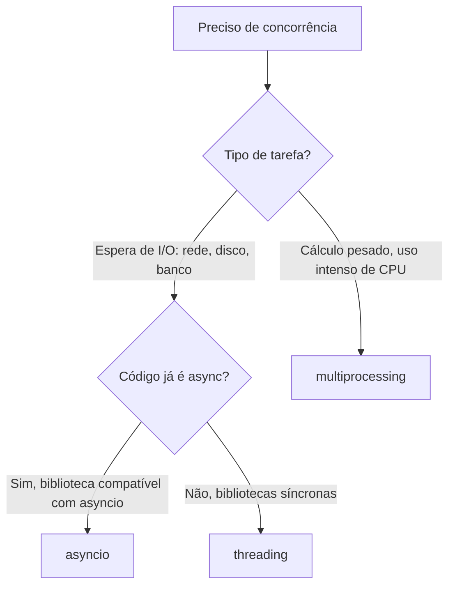

# Concorrência

Quando um programa precisa fazer várias coisas "ao mesmo tempo" - esperar várias respostas de rede, processar vários arquivos grandes, atender vários usuários simultaneamente - rodar tudo em sequência desperdiça tempo. Python tem três abordagens diferentes para concorrência, cada uma resolvendo um tipo de problema diferente.

## O GIL

O **GIL** (Global Interpreter Lock) é um mecanismo interno do CPython (a implementação padrão do Python) que garante que só uma thread execute bytecode Python por vez, mesmo em uma máquina com vários núcleos de processador. Ele existe para simplificar o gerenciamento de memória do interpretador, mas tem um efeito colateral conhecido: threads Python não ganham desempenho real em tarefas que dependem só de CPU.

O impacto do GIL depende do tipo de tarefa:

- **CPU-bound** (cálculo pesado, processamento de dados): threads não ajudam, porque o GIL impede a execução simultânea de bytecode - use `multiprocessing` nesse caso
- **I/O-bound** (esperar rede, disco, banco de dados): threads ajudam bastante, porque o GIL é liberado durante a espera por I/O

Desde o Python 3.13, existe uma build experimental **free-threaded** (sem GIL, proposta na [PEP 703](https://peps.python.org/pep-0703/)), que passou a ter critérios formais de suporte definidos na PEP 779, com o Python 3.14 mirando esse suporte mais oficial. Ainda é uma variante opcional, instalada separadamente - o build padrão do CPython continua com o GIL ativo, e nem toda biblioteca com extensões em C já é compatível com o modo sem GIL.

## `threading`

Para tarefas de I/O, `threading` permite que o programa continue fazendo outra coisa enquanto espera uma operação lenta terminar:

```python
import threading
import time

def baixar_arquivo(nome: str):
    print(f"Baixando {nome}...")
    time.sleep(2)  # simula uma espera de rede
    print(f"{nome} baixado")

threads = [threading.Thread(target=baixar_arquivo, args=(f"arquivo{i}.txt",)) for i in range(3)]

for t in threads:
    t.start()

for t in threads:
    t.join()  # espera cada thread terminar antes de seguir
```

As três chamadas de `baixar_arquivo` rodam concorrentemente - o tempo total fica próximo de 2 segundos (o tempo de uma única espera), não 6 segundos (a soma das três).

## `multiprocessing` e `concurrent.futures`

Para tarefas que dependem de CPU, `multiprocessing` cria processos de sistema operacional separados - cada um com seu próprio interpretador Python e seu próprio GIL, contornando a limitação de `threading`:

```python
from concurrent.futures import ProcessPoolExecutor, ThreadPoolExecutor

def calculo_pesado(n: int) -> int:
    return sum(i * i for i in range(n))

# CPU-bound: processos
with ProcessPoolExecutor() as executor:
    resultados = list(executor.map(calculo_pesado, [10_000_000, 20_000_000, 30_000_000]))

# I/O-bound: threads
with ThreadPoolExecutor() as executor:
    resultados = list(executor.map(baixar_arquivo, ["a.txt", "b.txt", "c.txt"]))
```

`concurrent.futures` é a interface moderna e recomendada para ambos os casos - `ProcessPoolExecutor` e `ThreadPoolExecutor` têm a mesma API, então trocar de um modelo de concorrência para outro é, na maioria das vezes, só uma questão de troca de classe.

## `asyncio`

`asyncio` é um terceiro modelo, baseado em um único thread que alterna entre várias tarefas sempre que uma delas está esperando algo (I/O), sem o custo de criar threads ou processos de verdade. É o modelo dominante em frameworks web modernos como o FastAPI:

```python
import asyncio

async def baixar_arquivo(nome: str):
    print(f"Baixando {nome}...")
    await asyncio.sleep(2)  # "pausa" essa tarefa, sem bloquear as outras
    print(f"{nome} baixado")

async def main():
    await asyncio.gather(
        baixar_arquivo("a.txt"),
        baixar_arquivo("b.txt"),
        baixar_arquivo("c.txt"),
    )

asyncio.run(main())
```

`async def` declara uma corrotina - uma função que pode ser pausada e retomada. `await` marca o ponto onde a corrotina "cede a vez" para outra tarefa rodar, geralmente esperando uma operação de I/O terminar. `asyncio.gather` roda várias corrotinas concorrentemente e espera todas terminarem.

A escolha entre os três modelos depende do tipo de tarefa:



## Referências

- [Documentação oficial - módulo asyncio](https://docs.python.org/3/library/asyncio.html)
- [Documentação oficial - módulo concurrent.futures](https://docs.python.org/3/library/concurrent.futures.html)
- [PEP 703 - Making the Global Interpreter Lock Optional in CPython](https://peps.python.org/pep-0703/)
- [Real Python - Speed Up Your Python Program With Concurrency](https://realpython.com/python-concurrency/)
